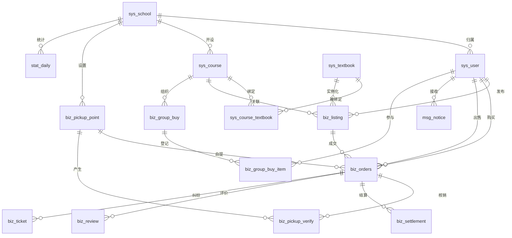
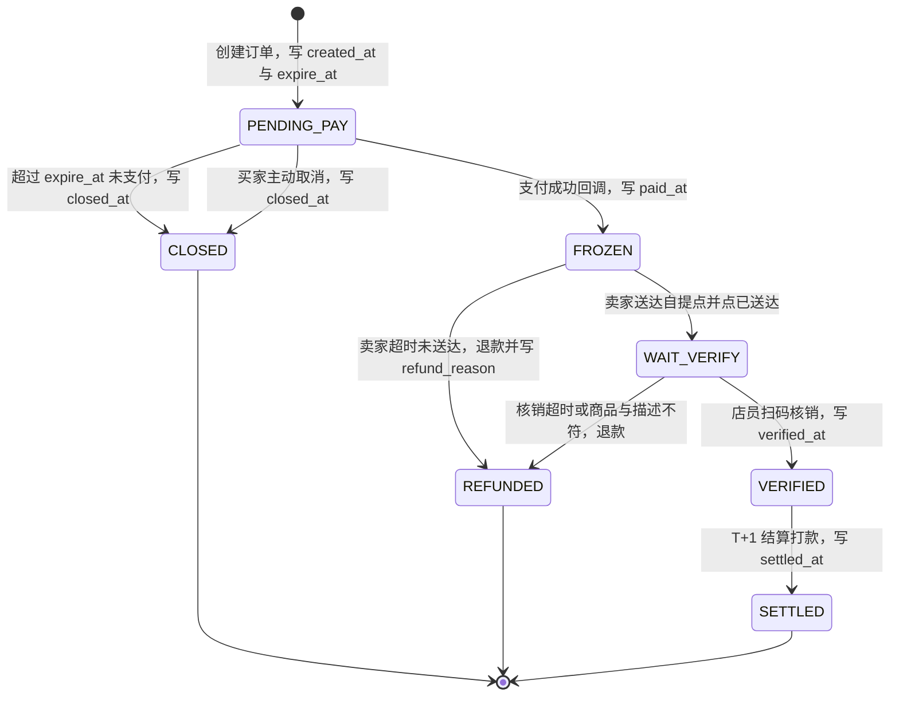

# 同窗书 —— 校园教材循环平台数据库设计

本设计对应库 `textbook_loop`，MySQL 8.0 与 InnoDB，共 24 张表、263 个字段，与 `db/schema.sql` 逐字一致。

## 一、设计原则

（1）满足第三范式。所有实体表都以自增 `id` 为主键，非主属性完全依赖主键，消除传递依赖：教材的出版社、版次只存于 `sys_textbook`，商品表只引用 `textbook_id`，不重复存放书名与版次；订单只存 `point_id` 与 `listing_id`，收货点名称、商品标题在查询时连接取得。这样做的直接收益是修改一处即全局生效，代价是读多表连接，对单校规模的数据量（订单十万级）可以接受。

（2）逻辑外键，不建物理外键。`listing_id`、`buyer_id`、`point_id` 等字段只保留语义与索引，不加 `FOREIGN KEY`。理由是三点：其一，分库与迁移成本，物理外键把两张表绑定在同一库同一引擎，后续按学校或时间分片时无法拆分；其二，高并发写入下外键检查会额外加共享锁，订单与商品状态的更新易形成锁等待甚至死锁；其三，逻辑约束由服务层与事务保证，出错位置更明确，历史数据清洗也不受外键顺序限制。

（3）统一命名前缀。`sys_` 表示系统与主数据（学校、用户、课程、教材、映射、幂等、后台日志），`biz_` 表示业务过程（商品、收藏、图片、订单、核销、结算、评价、信用、工单、接龙、埋点），`msg_` 表示消息通知，`stat_` 表示统计汇总。`user_auth` 虽无前缀，但语义属于系统域，命名沿用凭据表的通用写法。

（4）统一审计字段。可编辑的实体表统一带 `created_at`、`updated_at`、`deleted` 三列：前两者由数据库 `CURRENT_TIMESTAMP` 与 `ON UPDATE CURRENT_TIMESTAMP` 自动维护，`deleted` 配合 MyBatis-Plus 的逻辑删除。流水与明细表（`biz_credit_log`、`biz_pickup_verify`、`biz_settlement`、`biz_track_event`、`sys_admin_log`、`stat_daily` 等）只保留 `created_at`，因为它们只追加、不修改；这一取舍记录在表结构说明中，不假装统一。

（5）金额统一 `DECIMAL(10,2)`，不用 `FLOAT` 或 `DOUBLE`：二进制浮点无法精确表示 0.1，累加后会出现 19.999999 这类误差，对账必然失败。成交额汇总用 `DECIMAL(12,2)`，佣金比例用 `DECIMAL(4,2)`，经纬度用 `DECIMAL(10,6)`。

（6）状态统一 `VARCHAR` 枚举而非 `TINYINT`：`status` 存 `ON_SALE`、`FROZEN` 等字面值，直接读库即可判断，省去维护编码表；代价是存储略大、排序按字典序，故状态排序一律在应用层用枚举顺序处理。同理，`role`、`verify_state`、`condition_level`、`bind_type`、`type` 全部使用字面值枚举。

## 二、全局 ER 图

图中三组关系值得说明。一是 1:N：`sys_school` 到 `sys_user`、`biz_listing` 到 `biz_orders` 都是"一行父记录对应多行子记录"，外键置于多端（`sys_user.school_id`、`biz_orders.listing_id`）。二是 M:N：课程与教材是多对多，`sys_course_textbook` 是中间表，但它不是纯关联表，还承载 `bind_type`、`teacher`、`semester`、`source` 四个属性，因此有独立 `id`；`biz_group_buy` 与 `sys_user` 之间同理由 `biz_group_buy_item` 连接，并带 `quantity`、`contact` 属性。三是被唯一键约束的 1:1：`biz_orders` 与 `biz_pickup_verify`、`biz_settlement` 在图上画为 1:N 以保持符号统一，实际由 `uk_order` 唯一键限制为一单一核销、一单一结算。图中未画出的 `biz_listing_image`、`biz_favorite`、`biz_credit_log`、`sys_idempotent`、`biz_track_event` 或是明细附表、或是不与主实体强关联的流水，在第三节清单中补齐。

## 三、表结构清单

| 表名 | 中文名 | 用途 | 预估数据量级 | 所属模块 |
| --- | --- | --- | --- | --- |
| sys_school | 学校 | 单校起步、多校预留 | 1~10 行 | 用户与认证 |
| sys_user | 用户 | 四角色共表 | 1 万行 | 用户与认证 |
| user_auth | 认证凭据 | 密码/微信/短信多通道 | 1 万行 | 用户与认证 |
| sys_course | 课程 | 教材映射的锚点 | 2000 行 | 课程教材知识库 |
| sys_textbook | 教材主数据 | 一 ISBN 一版一条 | 8000 行 | 课程教材知识库 |
| sys_course_textbook | 课程教材映射 | 指定/参考与版本校验 | 5000 行 | 课程教材知识库 |
| biz_listing | 商品 | 二手书在售条目 | 5 万行 | 商品发布 |
| biz_listing_image | 商品图片 | 多图与 MD5 去重 | 20 万行 | 商品发布 |
| biz_favorite | 收藏 | 推荐共现信号 | 10 万行 | 检索推荐 |
| biz_orders | 订单 | 担保交易核心 | 10 万行 | 订单交易 |
| sys_idempotent | 幂等表 | 请求与回调去重 | 10 万行 | 订单交易 |
| biz_pickup_point | 自提点 | 线下履约节点 | 20 行 | 自提核销 |
| biz_pickup_verify | 核销记录 | 线下交付凭证 | 5 万行 | 自提核销 |
| biz_settlement | 结算流水 | T+1 打款记录 | 5 万行 | 自提核销 |
| biz_review | 评价 | 买卖双向评价 | 8 万行 | 信用纠纷 |
| biz_credit_log | 信用分流水 | 每次变动可追溯 | 20 万行 | 信用纠纷 |
| biz_ticket | 纠纷工单 | 争议处理 | 5000 行 | 信用纠纷 |
| biz_ticket_message | 工单消息 | 双方与客服往来 | 3 万行 | 信用纠纷 |
| biz_group_buy | 班级接龙 | 以课程为单位聚合需求 | 5000 行 | 接龙与看板 |
| biz_group_buy_item | 接龙登记 | 每人每团一条 | 5 万行 | 接龙与看板 |
| msg_notice | 站内消息 | 系统与订单通知 | 100 万行 | 接龙与看板 |
| biz_track_event | 埋点事件 | 漏斗分析数据源 | 1000 万行 | 接龙与看板 |
| stat_daily | 每日统计 | 看板直接读 | 每日每校 1 行 | 接龙与看板 |
| sys_admin_log | 后台操作日志 | 审核与处置审计 | 3 万行 | 用户与认证 |

## 四、逐表字段说明

### 4.1 sys_school 学校

| 字段 | 类型 | 允许空 | 默认 | 说明 |
| --- | --- | --- | --- | --- |
| id | BIGINT | 否 | 自增 | 主键 |
| name | VARCHAR(64) | 否 | 无 | 学校名称 |
| city | VARCHAR(32) | 否 | '' | 所在城市 |
| province | VARCHAR(32) | 否 | '' | 所在省份 |
| student_num | INT | 否 | 0 | 在校生规模，用于渗透率测算 |
| status | VARCHAR(16) | 否 | 'ENABLED' | ENABLED/DISABLED |
| created_at | DATETIME | 否 | CURRENT_TIMESTAMP | 创建时间 |
| updated_at | DATETIME | 否 | CURRENT_TIMESTAMP | 更新时间，更新自动刷新 |
| deleted | TINYINT | 否 | 0 | 逻辑删除位 |

索引：主键 `id`，普通索引 `idx_city(city)`。表内仅个位数行，索引并非为检索服务，而是为后续多校运营按地域筛选预留；`student_num` 是冗余计数而非由 `sys_user` 实时聚合，因为它描述的是学校规模而非平台注册量，两者需要对比计算渗透率，不可相互推导。

### 4.2 sys_user 用户

| 字段 | 类型 | 允许空 | 默认 | 说明 |
| --- | --- | --- | --- | --- |
| id | BIGINT | 否 | 自增 | 主键 |
| openid | VARCHAR(64) | 否 | '' | 微信 openid |
| nickname | VARCHAR(64) | 否 | '' | 昵称 |
| avatar | VARCHAR(255) | 否 | '' | 头像 URL |
| phone | VARCHAR(20) | 否 | '' | 手机号，加密存储可扩展 |
| real_name | VARCHAR(32) | 否 | '' | 真实姓名 |
| student_no | VARCHAR(32) | 否 | '' | 学号 |
| school_id | BIGINT | 否 | 0 | 学校 ID |
| college | VARCHAR(64) | 否 | '' | 学院 |
| major | VARCHAR(64) | 否 | '' | 专业 |
| grade | VARCHAR(16) | 否 | '' | 年级，如 2023 |
| dorm | VARCHAR(64) | 否 | '' | 宿舍楼/房间，用于距离排序 |
| credit_score | INT | 否 | 100 | 信用分，默认 100 |
| role | VARCHAR(16) | 否 | 'STUDENT' | STUDENT/LEADER/CLERK/ADMIN |
| verify_state | VARCHAR(16) | 否 | 'UNVERIFIED' | UNVERIFIED/PENDING/VERIFIED/REJECTED |
| status | VARCHAR(16) | 否 | 'NORMAL' | NORMAL/FROZEN |
| last_login | DATETIME | 是 | NULL | 最后登录时间 |
| created_at | DATETIME | 否 | CURRENT_TIMESTAMP | 创建时间 |
| updated_at | DATETIME | 否 | CURRENT_TIMESTAMP | 更新时间 |
| deleted | TINYINT | 否 | 0 | 逻辑删除位 |

索引：`uk_openid(openid)` 保证一个微信身份一个账号，登录查询直接命中；`idx_phone(phone)` 服务手机号登录与后台检索，未加唯一约束是因为注册主键是 openid，手机号为后绑定属性；`idx_student(school_id, student_no)` 支撑实名审核时按学校加学号定位；`idx_role(role)` 用于后台按角色筛选店员与管理员。角色只有四值，卖家身份由 `biz_listing.seller_id` 表达，不占角色位。

### 4.3 user_auth 用户认证凭据

| 字段 | 类型 | 允许空 | 默认 | 说明 |
| --- | --- | --- | --- | --- |
| id | BIGINT | 否 | 自增 | 主键 |
| user_id | BIGINT | 否 | 无 | 用户 ID |
| auth_type | VARCHAR(16) | 否 | 无 | PASSWORD/WECHAT/SMS |
| identifier | VARCHAR(64) | 否 | 无 | 登录名/手机号/openid |
| credential | VARCHAR(128) | 否 | '' | BCrypt 密码密文或凭证 |
| verified | TINYINT | 否 | 1 | 是否已验证 |
| created_at | DATETIME | 否 | CURRENT_TIMESTAMP | 创建时间 |
| updated_at | DATETIME | 否 | CURRENT_TIMESTAMP | 更新时间 |
| deleted | TINYINT | 否 | 0 | 逻辑删除位 |

索引：`uk_type_identifier(auth_type, identifier)` 是登录入口的唯一约束，保证同一通道下同一标识只能绑定一个账号，同时使"用密码登录"只需一次索引查找；`idx_user(user_id)` 用于查某用户的全部凭据。凭据独立成表而非混在 `sys_user` 中，是为了让微信、密码、短信三类通道各自有独立生命周期，也便于后续接入第三方登录而不改主表。

### 4.4 sys_course 课程

| 字段 | 类型 | 允许空 | 默认 | 说明 |
| --- | --- | --- | --- | --- |
| id | BIGINT | 否 | 自增 | 主键 |
| school_id | BIGINT | 否 | 无 | 学校 ID |
| code | VARCHAR(32) | 否 | '' | 课程代码 |
| name | VARCHAR(64) | 否 | 无 | 课程名 |
| college | VARCHAR(64) | 否 | '' | 开课学院 |
| major | VARCHAR(64) | 否 | '' | 适用专业，空表示通用 |
| term | VARCHAR(16) | 否 | '' | 学期，如 2026-2027-1 |
| teacher | VARCHAR(32) | 否 | '' | 授课教师 |
| credit | DECIMAL(3,1) | 否 | 0.0 | 学分 |
| status | VARCHAR(16) | 否 | 'ENABLED' | 启用状态 |
| created_at | DATETIME | 否 | CURRENT_TIMESTAMP | 创建时间 |
| updated_at | DATETIME | 否 | CURRENT_TIMESTAMP | 更新时间 |
| deleted | TINYINT | 否 | 0 | 逻辑删除位 |

索引：`idx_school_major(school_id, major)` 服务"按学校与专业查培养方案课程"的列表页；`idx_name(name)` 服务课程名模糊检索与联想。课程代码 `code` 未建唯一键，因为它是教务系统外部键，不同来源的课程可能存在空值或重复录入，去重交由导入任务处理，此处不做强约束以免阻断导入。

### 4.5 sys_textbook 教材主数据

| 字段 | 类型 | 允许空 | 默认 | 说明 |
| --- | --- | --- | --- | --- |
| id | BIGINT | 否 | 自增 | 主键 |
| isbn13 | VARCHAR(13) | 否 | '' | ISBN-13 |
| isbn10 | VARCHAR(10) | 否 | '' | ISBN-10 |
| title | VARCHAR(128) | 否 | 无 | 书名 |
| subtitle | VARCHAR(128) | 否 | '' | 副标题 |
| author | VARCHAR(128) | 否 | '' | 作者 |
| publisher | VARCHAR(64) | 否 | '' | 出版社 |
| edition | VARCHAR(32) | 否 | '' | 版次，如 第七版 |
| publish_year | SMALLINT | 否 | 0 | 出版年 |
| price | DECIMAL(10,2) | 否 | 0.00 | 定价 |
| cover_url | VARCHAR(255) | 否 | '' | 封面图 |
| category | VARCHAR(32) | 否 | '公共课' | 公共课/专业基础/专业核心/通识 |
| status | VARCHAR(16) | 否 | 'ENABLED' | 启用状态 |
| created_at | DATETIME | 否 | CURRENT_TIMESTAMP | 创建时间 |
| updated_at | DATETIME | 否 | CURRENT_TIMESTAMP | 更新时间 |
| deleted | TINYINT | 否 | 0 | 逻辑删除位 |

索引：`uk_isbn13(isbn13)` 是版本去重的关键，扫码录入时先按它查库，命中即复用；`idx_title(title)` 支撑书名前缀检索；`idx_publisher(publisher)` 支撑按出版社筛选。`edition` 单列存放而不拼进 `title`，是为了既能按版次过滤、又能按版次聚合统计，同时避免"第七版"与"第7版"生成两条重复记录。

### 4.6 sys_course_textbook 课程教材映射

| 字段 | 类型 | 允许空 | 默认 | 说明 |
| --- | --- | --- | --- | --- |
| id | BIGINT | 否 | 自增 | 主键 |
| course_id | BIGINT | 否 | 无 | 课程 ID |
| textbook_id | BIGINT | 否 | 无 | 教材 ID |
| bind_type | VARCHAR(16) | 否 | 'REQUIRED' | REQUIRED 指定/REFERENCE 参考 |
| teacher | VARCHAR(32) | 否 | '' | 授课教师，版本校验第三重 |
| semester | VARCHAR(16) | 否 | '' | 适用学期 |
| source | VARCHAR(16) | 否 | 'MANUAL' | MANUAL 人工/OCR 识别/学生补充 |
| created_at | DATETIME | 否 | CURRENT_TIMESTAMP | 创建时间 |
| updated_at | DATETIME | 否 | CURRENT_TIMESTAMP | 更新时间 |
| deleted | TINYINT | 否 | 0 | 逻辑删除位 |

索引：`uk_course_textbook(course_id, textbook_id)` 保证同一课程不会重复绑定同一教材，也使"查某课程的教材清单"走覆盖索引；`idx_textbook(textbook_id)` 反向支撑"这本教材被哪些课程使用"，用于商品详情页展示适用课程。`bind_type` 区分必修与参考，是学生判断"是否必须买这一版"的直接依据。

### 4.7 biz_listing 二手书商品

| 字段 | 类型 | 允许空 | 默认 | 说明 |
| --- | --- | --- | --- | --- |
| id | BIGINT | 否 | 自增 | 主键 |
| seller_id | BIGINT | 否 | 无 | 卖家 |
| textbook_id | BIGINT | 否 | 无 | 教材 ID |
| course_id | BIGINT | 否 | 0 | 关联课程，用于同课匹配 |
| title | VARCHAR(160) | 否 | 无 | 展示标题（书名+版次） |
| price | DECIMAL(10,2) | 否 | 无 | 售价 |
| original_price | DECIMAL(10,2) | 否 | 0.00 | 原价（定价） |
| condition_level | VARCHAR(16) | 否 | 'LIKE_NEW' | NEW/LIKE_NEW 九成新/GOOD 八成新/FAIR 有笔记/POOR |
| description | VARCHAR(500) | 否 | '' | 描述 |
| cover_url | VARCHAR(255) | 否 | '' | 封面（首图） |
| image_count | INT | 否 | 0 | 图片数 |
| dorm | VARCHAR(64) | 否 | '' | 所在宿舍楼 |
| status | VARCHAR(16) | 否 | 'ON_SALE' | ON_SALE/LOCKED/SOLD/OFFLINE/REJECTED |
| view_count | INT | 否 | 0 | 浏览数 |
| favorite_count | INT | 否 | 0 | 收藏数 |
| reject_reason | VARCHAR(255) | 否 | '' | 驳回或下架原因 |
| published_at | DATETIME | 是 | NULL | 上架时间，排序用 |
| created_at | DATETIME | 否 | CURRENT_TIMESTAMP | 创建时间 |
| updated_at | DATETIME | 否 | CURRENT_TIMESTAMP | 更新时间 |
| deleted | TINYINT | 否 | 0 | 逻辑删除位 |

索引：`idx_textbook_status(textbook_id, status)` 同时服务商品详情页的同款列表与定价参考聚合；`idx_seller(seller_id, status)` 服务"我发布的"按状态分页；`idx_course_status(course_id, status)` 服务同课程聚合；`idx_status_time(status, published_at)` 服务首页与检索页"在售 + 最新"排序，避免排序时全表扫描。`title` 冗余存储"书名+版次"是为了让列表页不必连接教材表即可展示，属可控冗余，教材改名时由后台批量刷新。

### 4.8 biz_listing_image 商品图片

| 字段 | 类型 | 允许空 | 默认 | 说明 |
| --- | --- | --- | --- | --- |
| id | BIGINT | 否 | 自增 | 主键 |
| listing_id | BIGINT | 否 | 无 | 商品 ID |
| url | VARCHAR(255) | 否 | '' | 图片地址 |
| md5 | VARCHAR(32) | 否 | '' | 文件 MD5，用于重复检测 |
| sort_no | INT | 否 | 0 | 排序号 |
| created_at | DATETIME | 否 | CURRENT_TIMESTAMP | 创建时间 |

索引：`idx_listing(listing_id, sort_no)` 使详情页按顺序取图无需额外排序；`idx_md5(md5)` 支撑"同卖家是否上传过相同图片"的判重查询。该表只有追加与删除，故不带 `updated_at` 与 `deleted`，删除时直接物理删行，图片的追溯价值低而存储成本高。

### 4.9 biz_favorite 收藏

| 字段 | 类型 | 允许空 | 默认 | 说明 |
| --- | --- | --- | --- | --- |
| id | BIGINT | 否 | 自增 | 主键 |
| user_id | BIGINT | 否 | 无 | 用户 ID |
| listing_id | BIGINT | 否 | 无 | 商品 ID |
| created_at | DATETIME | 否 | CURRENT_TIMESTAMP | 收藏时间 |

索引：`uk_user_listing(user_id, listing_id)` 既保证不重复收藏，又直接服务"我的收藏"列表；`idx_listing(listing_id)` 用于统计某商品被收藏次数。收藏在本项目中还有第二重用途：它是 ItemCF 的共现信号来源，离线任务按 `user_id` 分组取出收藏序列计算商品相似度。

### 4.10 biz_orders 订单

| 字段 | 类型 | 允许空 | 默认 | 说明 |
| --- | --- | --- | --- | --- |
| id | BIGINT | 否 | 自增 | 主键 |
| order_no | VARCHAR(32) | 否 | 无 | 订单号，TB+yyyyMMddHHmmss+6 位随机 |
| buyer_id | BIGINT | 否 | 无 | 买家 |
| seller_id | BIGINT | 否 | 无 | 卖家 |
| listing_id | BIGINT | 否 | 无 | 商品 ID |
| textbook_id | BIGINT | 否 | 0 | 教材 ID，冗余便于按书统计 |
| point_id | BIGINT | 否 | 无 | 自提点 |
| amount | DECIMAL(10,2) | 否 | 无 | 商品金额 |
| commission | DECIMAL(10,2) | 否 | 0.00 | 平台服务费 |
| status | VARCHAR(16) | 否 | 'PENDING_PAY' | PENDING_PAY/FROZEN/WAIT_VERIFY/VERIFIED/SETTLED/REFUNDED/CLOSED |
| verify_code | VARCHAR(64) | 否 | '' | 核销码，HMAC 生成，30 秒轮换 |
| pay_channel | VARCHAR(16) | 否 | 'MOCK' | WECHAT/MOCK |
| trade_no | VARCHAR(64) | 否 | '' | 第三方支付流水号 |
| remark | VARCHAR(255) | 否 | '' | 备注 |
| refund_reason | VARCHAR(255) | 否 | '' | 退款原因 |
| expire_at | DATETIME | 否 | 无 | 支付超时时间，15 分钟 |
| paid_at | DATETIME | 是 | NULL | 支付时间 |
| verified_at | DATETIME | 是 | NULL | 核销时间 |
| settled_at | DATETIME | 是 | NULL | 结算时间 |
| closed_at | DATETIME | 是 | NULL | 关闭时间 |
| created_at | DATETIME | 否 | CURRENT_TIMESTAMP | 创建时间 |
| updated_at | DATETIME | 否 | CURRENT_TIMESTAMP | 更新时间 |
| deleted | TINYINT | 否 | 0 | 逻辑删除位 |

索引：`uk_order_no(order_no)` 是外部唯一标识，对外接口一律用订单号而非自增主键，避免暴露业务量；`idx_buyer(buyer_id, status)` 服务"我的订单"按状态分页；`idx_seller(seller_id, status)` 服务卖家侧订单；`idx_listing(listing_id)` 用于查某商品的历史成交，也是定价参考的子查询入口；`idx_status_expire(status, expire_at)` 专为超时关单任务设计，使每分钟的扫描只触碰 `PENDING_PAY` 且已过期的少量行。四个时间字段分别记录四类事件，使状态机每一步都有时间戳可查。

### 4.11 sys_idempotent 幂等表

| 字段 | 类型 | 允许空 | 默认 | 说明 |
| --- | --- | --- | --- | --- |
| request_id | VARCHAR(64) | 否 | 无 | 客户端 requestId 或回调流水号 |
| scene | VARCHAR(32) | 否 | '' | CREATE_ORDER/PAY_CALLBACK/VERIFY |
| result | VARCHAR(255) | 否 | '' | 首次处理结果摘要 |
| created_at | DATETIME | 否 | CURRENT_TIMESTAMP | 创建时间 |

索引：主键 `(request_id, scene)`，无独立自增列。这里刻意用业务键做主键，因为插入即加锁、主键冲突即代表重复请求，省去"先查再插"的竞态窗口；`scene` 参与主键使同一 requestId 可用于不同场景而互不干扰。该表随订单增长，需要按 `created_at` 定期清理超过七天的记录。

### 4.12 biz_pickup_point 自提点

| 字段 | 类型 | 允许空 | 默认 | 说明 |
| --- | --- | --- | --- | --- |
| id | BIGINT | 否 | 自增 | 主键 |
| school_id | BIGINT | 否 | 无 | 学校 ID |
| name | VARCHAR(64) | 否 | 无 | 名称，如 图书馆西门 |
| address | VARCHAR(128) | 否 | '' | 地址 |
| longitude | DECIMAL(10,6) | 否 | 0 | 经度 |
| latitude | DECIMAL(10,6) | 否 | 0 | 纬度 |
| open_time | VARCHAR(16) | 否 | '12:00' | 营业开始 |
| close_time | VARCHAR(16) | 否 | '21:00' | 营业结束 |
| capacity | INT | 否 | 200 | 货位容量 |
| manager_id | BIGINT | 否 | 0 | 店员用户 ID |
| status | VARCHAR(16) | 否 | 'ENABLED' | 启用状态 |
| created_at | DATETIME | 否 | CURRENT_TIMESTAMP | 创建时间 |
| updated_at | DATETIME | 否 | CURRENT_TIMESTAMP | 更新时间 |
| deleted | TINYINT | 否 | 0 | 逻辑删除位 |

索引：`idx_school(school_id, status)` 服务下单页的可用自提点列表。营业时间用两个 `VARCHAR(16)` 存 `HH:mm` 而非 `TIME` 类型，是为了与前端时间选择器的字符串直接对应、避免时区转换；`capacity` 只是容量提示，不做严格的实时占位扣减，避免为极低频的满仓场景引入额外事务。经纬度保留六位小数（约 0.1 米精度），校园场景足够。

### 4.13 biz_pickup_verify 核销记录

| 字段 | 类型 | 允许空 | 默认 | 说明 |
| --- | --- | --- | --- | --- |
| id | BIGINT | 否 | 自增 | 主键 |
| order_id | BIGINT | 否 | 无 | 订单 ID |
| order_no | VARCHAR(32) | 否 | '' | 订单号冗余 |
| point_id | BIGINT | 否 | 无 | 自提点 |
| operator_id | BIGINT | 否 | 无 | 核销店员 |
| code | VARCHAR(64) | 否 | '' | 核销码 |
| method | VARCHAR(16) | 否 | 'SCAN' | SCAN/MANUAL |
| client_ip | VARCHAR(45) | 否 | '' | 客户端地址 |
| verified_at | DATETIME | 否 | CURRENT_TIMESTAMP | 核销时间 |

索引：`uk_order(order_id)` 是防重复核销的最后一道闸门，同一订单第二次插入必然失败；`idx_point_time(point_id, verified_at)` 服务自提点当日报表与店员工作量统计。该表以 `verified_at` 兼作时间戳，不再单设 `created_at`，因为两者在语义上就是同一时刻。`client_ip` 用 `VARCHAR(45)` 以容纳 IPv6 地址，为纠纷追溯保留证据。

### 4.14 biz_settlement 结算流水

| 字段 | 类型 | 允许空 | 默认 | 说明 |
| --- | --- | --- | --- | --- |
| id | BIGINT | 否 | 自增 | 主键 |
| order_id | BIGINT | 否 | 无 | 订单 ID |
| order_no | VARCHAR(32) | 否 | '' | 订单号冗余 |
| seller_id | BIGINT | 否 | 无 | 卖家 |
| amount | DECIMAL(10,2) | 否 | 无 | 结算给卖家金额 = 订单金额 - 服务费 |
| commission | DECIMAL(10,2) | 否 | 0.00 | 平台服务费 |
| status | VARCHAR(16) | 否 | 'PENDING' | PENDING/DONE/FAILED |
| batch_no | VARCHAR(32) | 否 | '' | 结算批次 |
| settle_at | DATETIME | 是 | NULL | 打款时间 |
| created_at | DATETIME | 否 | CURRENT_TIMESTAMP | 创建时间 |

索引：`uk_order(order_id)` 保证一单一结算，核销事务重复执行也不会产生两笔打款；`idx_seller_status(seller_id, status)` 服务"我的收入"与后台待结算清单。`amount` 与 `commission` 都落库而非由订单实时相减，因为费率可能随活动调整，历史单据必须保留当时的计算结果。

### 4.15 biz_review 评价

| 字段 | 类型 | 允许空 | 默认 | 说明 |
| --- | --- | --- | --- | --- |
| id | BIGINT | 否 | 自增 | 主键 |
| order_id | BIGINT | 否 | 无 | 订单 ID |
| reviewer_id | BIGINT | 否 | 无 | 评价人 |
| target_id | BIGINT | 否 | 无 | 被评价人 |
| reviewer_role | VARCHAR(8) | 否 | 'BUYER' | BUYER/SELLER |
| rating | TINYINT | 否 | 5 | 1~5 星 |
| content | VARCHAR(500) | 否 | '' | 评价内容 |
| images | VARCHAR(500) | 否 | '' | 逗号分隔的图片地址 |
| anonymous | TINYINT | 否 | 0 | 是否匿名展示 |
| status | VARCHAR(16) | 否 | 'VISIBLE' | VISIBLE/HIDDEN |
| created_at | DATETIME | 否 | CURRENT_TIMESTAMP | 创建时间 |

索引：`uk_order_role(order_id, reviewer_role)` 保证同一订单买方与卖方各只能评价一次，同时使"该订单我评过没有"只需一次索引探测；`idx_target(target_id, status)` 服务用户主页的评价列表，并过滤被管理员隐藏的条目。`anonymous` 只影响展示层是否显示昵称与头像，`reviewer_id` 始终保留，以便纠纷时追溯。

### 4.16 biz_credit_log 信用分流水

| 字段 | 类型 | 允许空 | 默认 | 说明 |
| --- | --- | --- | --- | --- |
| id | BIGINT | 否 | 自增 | 主键 |
| user_id | BIGINT | 否 | 无 | 用户 ID |
| change_val | INT | 否 | 无 | 变动值，可为负 |
| score_after | INT | 否 | 无 | 变动后分数 |
| reason | VARCHAR(64) | 否 | '' | DEAL_DONE/REVIEW_GOOD/TIMEOUT/FAKE_BOOK/DISPUTE_LOST |
| ref_type | VARCHAR(16) | 否 | '' | 关联单据类型 |
| ref_id | BIGINT | 否 | 0 | 关联单据 ID |
| created_at | DATETIME | 否 | CURRENT_TIMESTAMP | 创建时间 |

索引：`idx_user_time(user_id, created_at)` 服务信用分明细页按时间倒序分页。`score_after` 是刻意的冗余：只存变动值的话，要还原任一时点分数必须从初始值累加全表，而存下结果后既可单行校验，也可用相邻两行验证不变式。`ref_type` 与 `ref_id` 指向来源单据，使一笔扣分能回溯到具体订单或工单；本表未在 `(user_id, reason, ref_type, ref_id)` 上建唯一索引，同一来源的重复加分只能靠服务层查重，属于已知取舍。

### 4.17 biz_ticket 纠纷工单

| 字段 | 类型 | 允许空 | 默认 | 说明 |
| --- | --- | --- | --- | --- |
| id | BIGINT | 否 | 自增 | 主键 |
| order_id | BIGINT | 否 | 0 | 订单 ID，0 表示与订单无关 |
| order_no | VARCHAR(32) | 否 | '' | 订单号冗余 |
| initiator_id | BIGINT | 否 | 无 | 发起人 |
| against_id | BIGINT | 否 | 0 | 被投诉人 |
| type | VARCHAR(16) | 否 | 'REFUND' | REFUND/FAKE_BOOK/CONDITION/OTHER |
| title | VARCHAR(128) | 否 | '' | 标题 |
| description | VARCHAR(1000) | 否 | '' | 问题描述 |
| images | VARCHAR(500) | 否 | '' | 逗号分隔的图片地址 |
| status | VARCHAR(16) | 否 | 'PENDING' | PENDING/PROCESSING/RESOLVED/REJECTED |
| result | VARCHAR(500) | 否 | '' | 处理结论 |
| handler_id | BIGINT | 否 | 0 | 处理人 |
| created_at | DATETIME | 否 | CURRENT_TIMESTAMP | 创建时间 |
| closed_at | DATETIME | 是 | NULL | 关闭时间 |

索引：`idx_status(status, created_at)` 服务后台"待处理工单"队列，按状态与时间取最久未处理的一条；`idx_order(order_id)` 用于订单详情页反查纠纷。`order_id` 允许为 0 是因为账号被盗、评价辱骂等问题不绑定订单；`result` 独立成列而非只存于消息表，保证结论可被列表页直接展示，避免 N+1 查询。

### 4.18 biz_ticket_message 工单消息

| 字段 | 类型 | 允许空 | 默认 | 说明 |
| --- | --- | --- | --- | --- |
| id | BIGINT | 否 | 自增 | 主键 |
| ticket_id | BIGINT | 否 | 无 | 工单 ID |
| sender_id | BIGINT | 否 | 无 | 发送人 |
| sender_role | VARCHAR(16) | 否 | 'USER' | USER/ADMIN |
| content | VARCHAR(1000) | 否 | '' | 内容 |
| images | VARCHAR(500) | 否 | '' | 逗号分隔的图片地址 |
| created_at | DATETIME | 否 | CURRENT_TIMESTAMP | 创建时间 |

索引：`idx_ticket(ticket_id, created_at)` 使会话消息按时间正序一次查出，无需额外排序。图片以逗号分隔的字符串存于单列而非独立附表，因为单条消息图片不超过九张、也只在本会话内展示，独立建表在查询上省不了连接，反而多一次映射。

### 4.19 biz_group_buy 班级接龙

| 字段 | 类型 | 允许空 | 默认 | 说明 |
| --- | --- | --- | --- | --- |
| id | BIGINT | 否 | 自增 | 主键 |
| course_id | BIGINT | 否 | 0 | 课程 ID |
| textbook_id | BIGINT | 否 | 0 | 教材 ID |
| leader_id | BIGINT | 否 | 无 | 团长（班委） |
| title | VARCHAR(128) | 否 | 无 | 标题，如 高数A 第七版 教材接龙 |
| target_count | INT | 否 | 40 | 目标册数 |
| unit_price | DECIMAL(10,2) | 否 | 0.00 | 预期单价 |
| invite_code | VARCHAR(16) | 否 | '' | 邀请码/短码 |
| current_count | INT | 否 | 0 | 已登记数量 |
| deadline | DATETIME | 否 | 无 | 截止时间 |
| status | VARCHAR(16) | 否 | 'OPEN' | OPEN/CLOSED/DONE/CANCELED |
| commission_rate | DECIMAL(4,2) | 否 | 0.10 | 团长佣金比例 |
| created_at | DATETIME | 否 | CURRENT_TIMESTAMP | 创建时间 |
| updated_at | DATETIME | 否 | CURRENT_TIMESTAMP | 更新时间 |
| deleted | TINYINT | 否 | 0 | 逻辑删除位 |

索引：`uk_invite(invite_code)` 使"输入邀请码进团"只需一次等值查找，也让生成时的冲突检测由数据库完成；`idx_leader(leader_id, status)` 服务"我发起的接龙"；`idx_status(status, deadline)` 服务到期自动关闭任务。`current_count` 是冗余计数，登记时用 `current_count = current_count + ?` 原子累加，避免并发登记时先查后改丢失更新，并由每日校准任务按明细重算。

### 4.20 biz_group_buy_item 接龙登记

| 字段 | 类型 | 允许空 | 默认 | 说明 |
| --- | --- | --- | --- | --- |
| id | BIGINT | 否 | 自增 | 主键 |
| group_buy_id | BIGINT | 否 | 无 | 接龙 ID |
| user_id | BIGINT | 否 | 无 | 参与者 |
| quantity | INT | 否 | 1 | 需求册数 |
| contact | VARCHAR(32) | 否 | '' | 联系方式 |
| status | VARCHAR(16) | 否 | 'JOINED' | JOINED/MATCHED/CANCELED |
| created_at | DATETIME | 否 | CURRENT_TIMESTAMP | 创建时间 |

索引：`uk_group_user(group_buy_id, user_id)` 保证一人一团一条登记，重复提交由数据库拒绝；`idx_group(group_buy_id)` 服务团长查看名册与导出。`contact` 是冗余的联系方式快照，因为参与者可能更换手机号，而团长需要的是登记当时可用的联系方式。

### 4.21 msg_notice 站内消息

| 字段 | 类型 | 允许空 | 默认 | 说明 |
| --- | --- | --- | --- | --- |
| id | BIGINT | 否 | 自增 | 主键 |
| user_id | BIGINT | 否 | 无 | 接收人 |
| type | VARCHAR(16) | 否 | 'SYSTEM' | SYSTEM/ORDER/CREDIT/TICKET |
| title | VARCHAR(128) | 否 | '' | 标题 |
| content | VARCHAR(500) | 否 | '' | 内容 |
| ref_type | VARCHAR(16) | 否 | '' | 关联单据类型 |
| ref_id | BIGINT | 否 | 0 | 关联单据 ID |
| read_flag | TINYINT | 否 | 0 | 0 未读 1 已读 |
| created_at | DATETIME | 否 | CURRENT_TIMESTAMP | 创建时间 |

索引：`idx_user_read(user_id, read_flag, created_at)` 是典型的三列联合索引，前两列等值、第三列排序，使"我的未读消息按时间倒序"一次索引扫描完成，也让未读数统计只读索引不回表。消息只追加不修改，已读状态用 `read_flag` 单列标记，量级可达百万，需按 `created_at` 定期归档。

### 4.22 biz_track_event 埋点事件

| 字段 | 类型 | 允许空 | 默认 | 说明 |
| --- | --- | --- | --- | --- |
| id | BIGINT | 否 | 自增 | 主键 |
| user_id | BIGINT | 否 | 0 | 用户 ID，0 表示未登录 |
| session_id | VARCHAR(64) | 否 | '' | 一次访问会话 |
| event | VARCHAR(32) | 否 | 无 | VIEW_LISTING/DETAIL/PUBLISH/CREATE_ORDER/PAY/VERIFY |
| ref_type | VARCHAR(16) | 否 | '' | 关联对象类型 |
| ref_id | BIGINT | 否 | 0 | 关联对象 ID |
| page | VARCHAR(64) | 否 | '' | 页面路径 |
| created_at | DATETIME | 否 | CURRENT_TIMESTAMP | 创建时间 |

索引：`idx_event_time(event, created_at)` 服务漏斗计算，按事件类型取当日数据；`idx_user(user_id, created_at)` 服务单用户行为轨迹。`user_id` 允许为 0，因为未登录浏览同样产生行为，漏斗按 `session_id` 去重而非按用户，才能在登录前也统计到转化。

### 4.23 stat_daily 每日统计

| 字段 | 类型 | 允许空 | 默认 | 说明 |
| --- | --- | --- | --- | --- |
| id | BIGINT | 否 | 自增 | 主键 |
| stat_date | DATE | 否 | 无 | 统计日期 |
| school_id | BIGINT | 否 | 0 | 学校 ID |
| gmv | DECIMAL(12,2) | 否 | 0.00 | 成交额 |
| order_count | INT | 否 | 0 | 订单数 |
| verify_count | INT | 否 | 0 | 核销数 |
| listing_count | INT | 否 | 0 | 新上架数 |
| new_user_count | INT | 否 | 0 | 新增用户数 |
| refund_count | INT | 否 | 0 | 退款数 |
| created_at | DATETIME | 否 | CURRENT_TIMESTAMP | 创建时间 |

索引：主键 `id`，唯一键 `uk_date_school(stat_date, school_id)`。保留自增主键是为了行定位与非聚簇索引的稳定，唯一键承担业务语义，使补数任务可以用 `ON DUPLICATE KEY UPDATE` 幂等重跑。`gmv` 用 `DECIMAL(12,2)` 而非 `(10,2)`，因为它是汇总值，量级比单笔金额高两个数量级。

### 4.24 sys_admin_log 后台操作日志

| 字段 | 类型 | 允许空 | 默认 | 说明 |
| --- | --- | --- | --- | --- |
| id | BIGINT | 否 | 自增 | 主键 |
| admin_id | BIGINT | 否 | 无 | 操作人 |
| action | VARCHAR(64) | 否 | 无 | LISTING_REJECT/USER_FREEZE/TICKET_RESOLVE |
| target | VARCHAR(64) | 否 | '' | 操作对象描述 |
| detail | VARCHAR(500) | 否 | '' | 详情 |
| ip | VARCHAR(45) | 否 | '' | 操作地址 |
| created_at | DATETIME | 否 | CURRENT_TIMESTAMP | 创建时间 |

索引：`idx_admin_time(admin_id, created_at)` 服务"某管理员近期操作"的审计视图。只追加、不修改、不删除，故没有 `updated_at` 与 `deleted`；`action` 用字面值枚举而非外键指向操作字典表，因为审计日志必须在任何字典被改动后仍保持原样可读。

## 五、关键设计说明

### 5.1 订单状态机

状态共七个，其中三个为终态。每次流转都由一个明确的触发动作产生，并写入对应时间字段：创建写 `created_at` 与 `expire_at`，支付写 `paid_at`，核销写 `verified_at`，结算写 `settled_at`，关闭写 `closed_at`，退款写 `refund_reason`。这样任一订单都能仅凭一行数据还原完整时间线，无需连接日志表。代码中用 `Map<OrderStatus, Set<OrderStatus>>` 维护允许的迁移集合，`verify`、`settle` 等操作统一调用 `transit` 方法，非法迁移直接抛业务异常；数据库侧不设触发器，因为业务规则需要可测试，放在服务层更易覆盖用例。

### 5.2 幂等表设计

`sys_idempotent` 用业务键做主键：`PRIMARY KEY (request_id, scene)`，不设自增 `id`。下单时先执行 `INSERT`，插入成功即代表本次请求抢到了处理权，接下来的业务在同一事务内完成并回填 `result` 快照；若插入抛出主键冲突，说明请求已在处理或已完成，直接读出 `result` 中的订单号返回，用户看到的是同一个订单而不是两个。`scene` 参与主键，使同一个 requestId 可以分别用于 `CREATE_ORDER`、`PAY_CALLBACK`、`VERIFY` 三个场景而互不覆盖。选择先插后做而不是先查后插，是因为后者存在两个并发请求同时查不到、同时执行的窗口，而主键冲突由存储引擎保证原子。该表随订单量线性增长，按 `created_at` 保留七天即可，历史请求没有必要永久去重。

### 5.3 核销码设计

核销码由三部分拼接后签名：`code = base64url( HMAC-SHA256(secret, orderId|nonce|expire) 的前 16 字节 ) + orderId|nonce|expire 的编码`，其中 `expire` 为十位秒级时间戳，`nonce` 为随机数。服务端验证时拆出原文、重算签名、逐字节比较，再检查 `expire` 是否在当前时间正负六十秒内，最后交给状态机判断订单是否为 `WAIT_VERIFY`。选对称 HMAC 而非非对称签名，是因为校验方就是签发方（同一后端），无需公钥分发，HMAC 的运算开销也低一个数量级。三十秒刷新窗口是安全与可用的折中：窗口太长则截图转发可被冒用，太短则自提点网络抖动时扫码失败率升高。防重放不依赖 nonce 记录表，而依赖三层机制叠加——时间窗口、状态机只允许从 `WAIT_VERIFY` 迁移一次、以及 `biz_pickup_verify.uk_order` 唯一键，即使前两层被绕过，第三层仍会在库层拒绝重复核销。密钥存放于环境变量，不写入代码与数据库。

### 5.4 日统计表预聚合

`stat_daily` 是典型的预聚合表，由每日凌晨的定时任务写入。若不预聚合，看板每次刷新都要对 `biz_orders` 按日期分组求和、对 `biz_pickup_verify` 计数、对 `sys_user` 计数，在十万级订单上单次查询需数百毫秒到秒级，且随数据增长持续变慢；预聚合把这些计算前移到业务低峰，查询退化为按 `stat_date` 范围读三十行，响应稳定在毫秒级。代价是数据延迟一天与存储冗余，前者通过"当日数据实时查、历史数据读统计表"的混合策略弥补，后者每日每校一行，可以忽略。`uk_date_school(stat_date, school_id)` 使补数任务可重复执行而不会产生重复行。

### 5.5 软删除与唯一索引的冲突处理

逻辑删除与唯一索引天然冲突：一行被标记 `deleted=1` 后，其唯一键仍占用命名空间，同一业务键无法再次插入；若把 `deleted` 纳入唯一键，则删除两次会产生两条 `deleted=1` 的重复行。本设计的处理分三类。第一类，业务上不允许重建的键直接不给删除机会，如 `biz_favorite` 取消收藏时物理删除，`uk_user_listing` 因此不受影响。第二类，键本身已含时间或随机成分，如 `biz_orders.uk_order_no`、`biz_pickup_verify.uk_order`、`biz_settlement.uk_order`，重复插入在语义上就该失败，`deleted` 不参与。第三类，确实需要"删除后可重建"的场景（如课程教材映射重建），规范做法是把 `deleted` 改为时间戳列并纳入唯一键，或在删除时把业务键改写为带后缀的墓碑值；`sys_course_textbook`、`sys_textbook.uk_isbn13`、`sys_user.uk_openid` 目前属于未做此处理的已知取舍，在单校小规模数据下由服务层在删除前检查冲突即可，若后续要支持"删了再加"必须改造唯一键。

## 六、索引与性能

### 6.1 关键索引

| 索引 | 所属表 | 服务的查询 |
| --- | --- | --- |
| idx_buyer(buyer_id, status) | biz_orders | 我的订单按状态分页，等值加排序一次完成 |
| idx_status_expire(status, expire_at) | biz_orders | 每分钟扫描待关闭订单，只触碰少量行 |
| idx_textbook_status(textbook_id, status) | biz_listing | 同款在售列表与定价参考聚合 |
| idx_status_time(status, published_at) | biz_listing | 首页与检索页"在售 + 最新"排序 |
| idx_user_read(user_id, read_flag, created_at) | msg_notice | 未读消息列表与未读数统计 |
| idx_target(target_id, status) | biz_review | 用户主页评价，过滤已隐藏条目 |
| uk_date_school(stat_date, school_id) | stat_daily | 看板按日期范围读统计，兼作补数幂等键 |
| uk_course_textbook(course_id, textbook_id) | sys_course_textbook | 课程教材清单，兼作唯一约束 |

这些索引的共同特征是"最左列等值、后续列排序或过滤"，使查询在一次索引扫描内完成而不产生文件排序。以 `idx_buyer(buyer_id, status)` 为例，若只建 `buyer_id` 单列索引，按状态过滤时仍需回表逐行判断，订单量大时明显变慢；把 `status` 放进索引后，过滤在索引层完成。

### 6.2 为何不给 biz_track_event 多建索引

埋点表是写多读少的极端场景：一次浏览可能产生数条事件，日均写入量可达数万行，而分析查询每天只跑几次。每个二级索引都会在插入时同步维护，索引越多写入越慢，还会占用缓冲池。因此该表只保留两个索引：`idx_event_time(event, created_at)` 供漏斗按事件与日期取数，`idx_user(user_id, created_at)` 供单用户轨迹回放。像 `page`、`ref_type` 这类低选择性列一律不建索引，需要时由离线任务全表扫描到临时表。治理方式是定期归档：只保留最近九十天明细，更早的数据聚合成日统计后删除。

### 6.3 stat_daily 的主键选择

`stat_daily` 用自增 `id` 作主键，另建 `uk_date_school(stat_date, school_id)` 唯一键，而不是直接用 `(stat_date, school_id)` 做复合主键。原因有三：其一，InnoDB 的表按主键顺序组织，用日期做前缀会导致新数据不断插入到已有页之间，页分裂与随机写增加；自增 `id` 保证顺序追加。其二，若将来需要引用统计行（如快照或订阅），单列主键比复合主键更易作为外键目标。其三，`uk_date_school` 已能满足补数任务的幂等写入与看板的范围查询，业务唯一性与主键职能分离，各司其职。

## 七、初始化与迁移

### 7.1 执行顺序

`db/schema.sql` 必须先于 `db/seed.sql` 执行，前者负责 `DROP DATABASE IF EXISTS textbook_loop`、建库、建表与建索引，后者只做数据插入。schema 脚本的第一行是删库语句，意味着重复执行会清空现有数据，仅可用于开发与演示环境；生产环境应改用增量迁移脚本（Flyway 或 Liquibase），并把建表语句固化为版本化的 `V1__init.sql`。seed 脚本按外键依赖顺序插入：先 `sys_school` 与 `sys_user`，再 `sys_course`、`sys_textbook`、`sys_course_textbook`，随后 `biz_pickup_point`、`biz_listing`、`biz_listing_image`，最后 `biz_group_buy`、`biz_group_buy_item` 与 `stat_daily`。脚本中不含明文密码，`admin`、`buyer001`、`seller001`、`clerk001` 的 BCrypt 密文由后端启动时的 `DataInitializer` 生成写入 `user_auth`，避免把哈希写死在 SQL 里。

### 7.2 字符集与排序规则

建库与建表均声明 `DEFAULT CHARSET=utf8mb4`，它用四个字节表示一个字符，能完整存储生僻字与 emoji，`utf8`（三个字节）在遇到四字节字符时会截断或报错，故不使用。排序规则取 `utf8mb4_general_ci`，它对中文按 Unicode 码位比较，不区分大小写，`ci` 使 `ISBN` 与 `isbn` 在查询与唯一键中视为同一值，符合业务预期；若需要更精确的语言学排序可换用 `utf8mb4_0900_ai_ci`，但会改变既有唯一键的比较语义，迁移前必须评估。

### 7.3 时区

所有时间列使用 `DATETIME` 而非 `TIMESTAMP`：`DATETIME` 不随时区转换，存什么读什么，便于对账与排查；`TIMESTAMP` 受 `time_zone` 影响，跨时区迁移时会整体偏移。默认值 `CURRENT_TIMESTAMP` 取数据库会话时区，因此必须在连接串中固定 `serverTimezone=Asia/Shanghai`，并保证容器与数据库时区一致，否则会出现"订单显示超时但实际未超时"的诡异现象。应用层统一使用 `LocalDateTime`，不做隐式转换；跨时区部署时应把所有时间按东八区存储，仅在展示层按客户端时区格式化。

### 7.4 H2 兼容模式的注意事项

单元测试用 H2 的 `MODE=MySQL` 以减少依赖，但它与 MySQL 8 存在差异，需逐条规避：其一，H2 不支持 `ENGINE=InnoDB DEFAULT CHARSET` 与 `COMMENT` 子句，测试脚本要另备一份去注释的建表语句，或用 Flyway 的数据库特定脚本分开维护；其二，H2 对 `ON UPDATE CURRENT_TIMESTAMP` 支持有限，测试中若依赖自动刷新 `updated_at`，应由 MyBatis-Plus 的自动填充代替，而不是依赖数据库；其三，`DECIMAL` 与 `TINYINT` 的行为基本一致，但 `TINYINT(1)` 在部分版本被映射为布尔，本项目统一写 `TINYINT` 不带长度以避免歧义；其四，`DROP DATABASE`、`USE` 等语句在 H2 中语法不同，测试环境应通过连接串指定库，不执行 schema 脚本的头部语句。设计上的原则是：业务逻辑不依赖数据库方言特性，能放到应用层的规则（如时间戳填充、状态校验）不放给数据库，这样两种环境的行为才可能一致。
