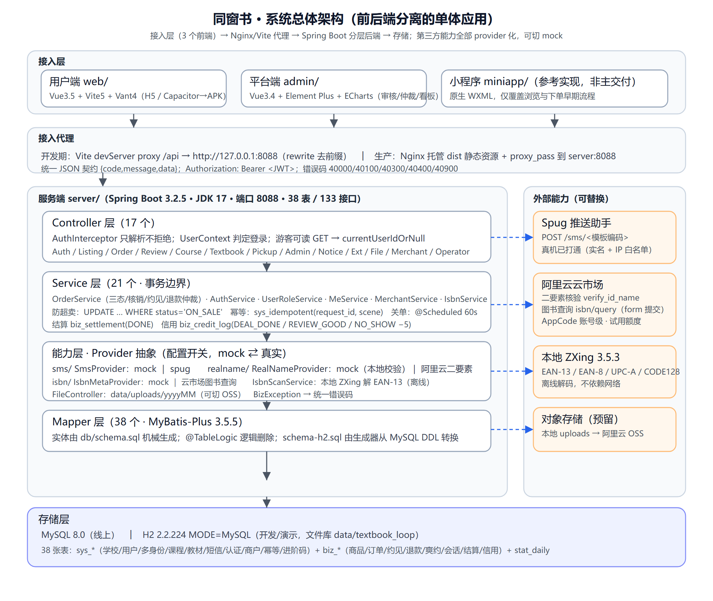
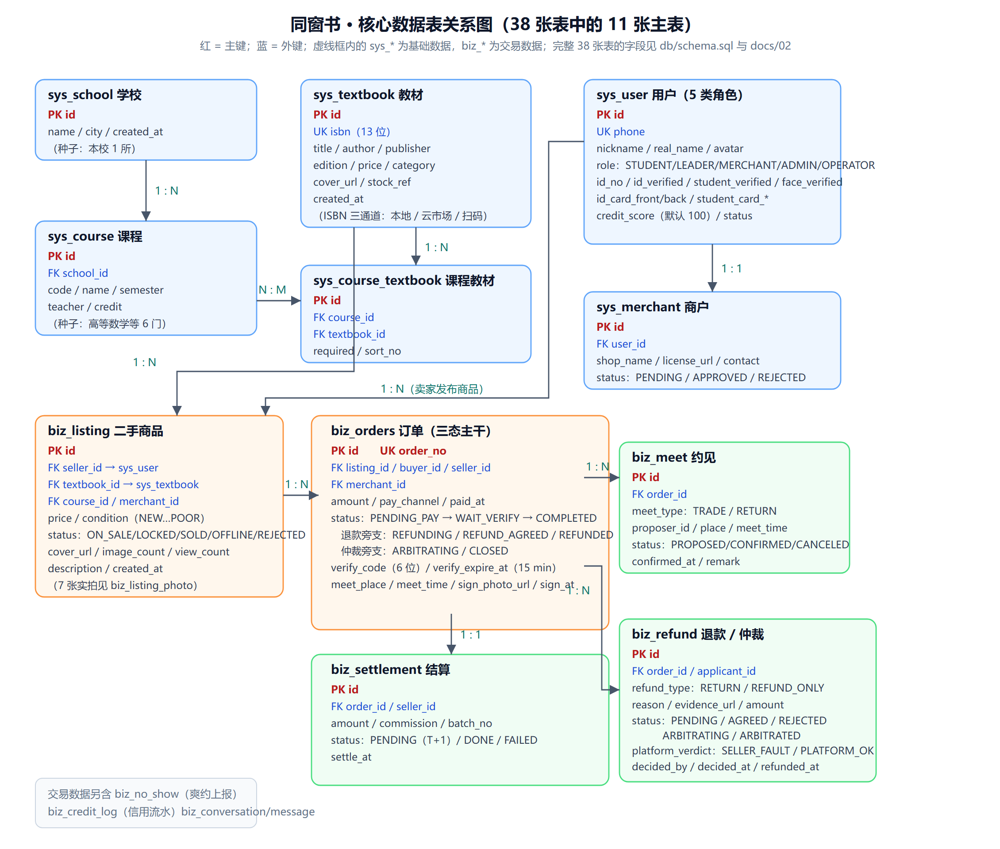
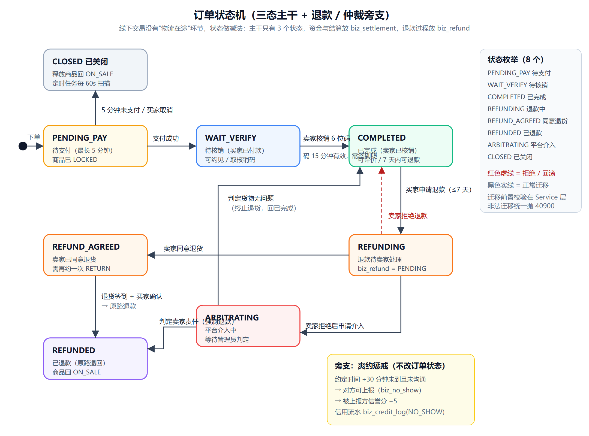
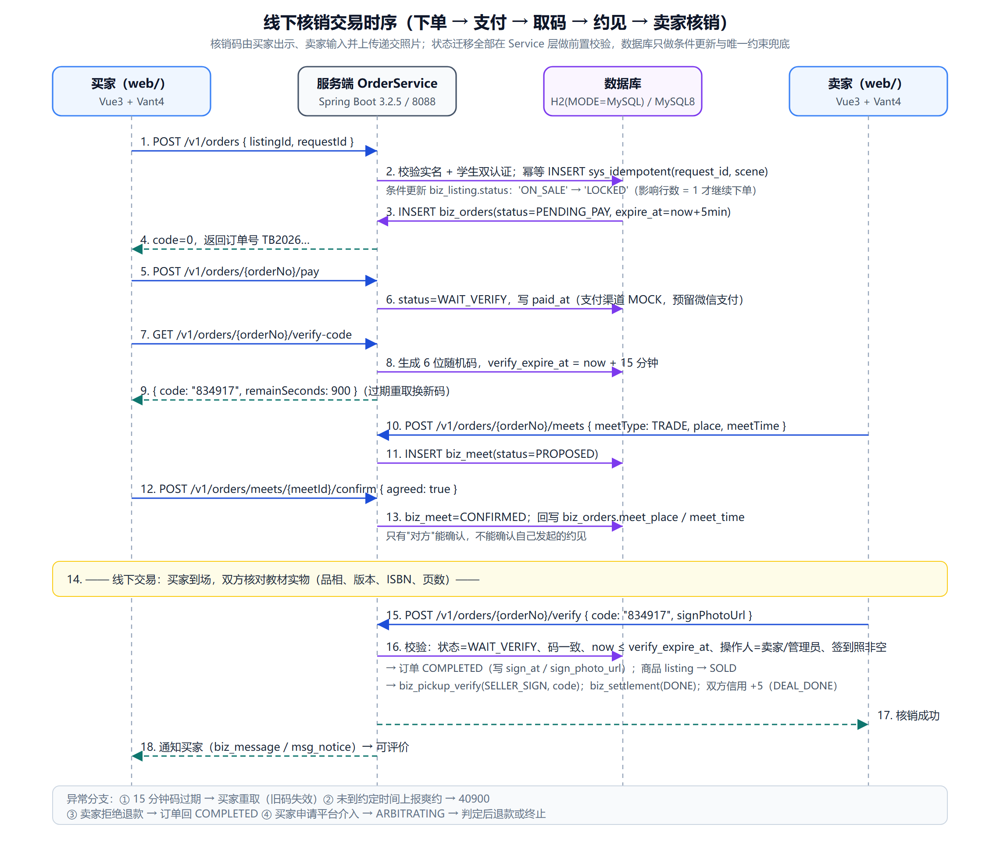

# 论文插图（4 张核心图 + 图源）

> 本目录图片可**直接插入论文**：`.png` 用于 Word/PDF 排版（2 倍缩放导出，清晰度足够），`.svg` 是矢量源文件，可用 Inkscape / draw.io / 浏览器打开后改字改色。
> 四张图对应任务书要求的「用例图 / 类图 / 时序图 / ER 图」中的工程实现部分；用例图可在 draw.io 里另行绘制，本文最后给了图注与图序建议。

## 图 1 系统总体架构

- 源文件：`docs/img/fig1-architecture.svg`
- 说明：三端（用户端 / 平台端 / 小程序参考实现）→ Vite 代理或 Nginx 反向代理 → Spring Boot 分层（Controller / Service / 能力层 Provider / Mapper）→ 存储；右侧是四个可替换的外部能力（Spug 短信、阿里云云市场二要素与图书查询、本地 ZXing、对象存储预留）。
- 论文写法：先讲"为什么是前后端分离的单体、不是微服务"，再讲 Provider 抽象的取舍（演示走 mock、上线只改配置）。

## 图 2 核心数据表关系（ER）

- 源文件：`docs/img/fig2-er.svg`
- 说明：11 张主表 + 主外键与 1:1 / 1:N / N:M 关系；完整 38 张表的字段定义见 `db/schema.sql` 与 `docs/02-数据库设计.md`。
- 论文写法：先给局部 ER（本文这张），再给"课程—教材—商品—订单—售后"这条主链的说明；不要把所有 38 张表画进一张图。

## 图 3 订单状态机

- 源文件：`docs/img/fig3-order-state.svg`
- 说明：主干 `PENDING_PAY → WAIT_VERIFY → COMPLETED`，旁支 `REFUNDING → REFUND_AGREED → REFUNDED`、`ARBITRATING`、`CLOSED`；红色虚线是拒绝/回滚路径；右下角是爽约惩戒（不改订单状态，只扣信誉分）。
- 论文写法：这是全文最能体现"设计"的一张图。重点讲**状态做减法的理由**（线下交易没有物流在途，状态越多非法迁移组合越多）与**迁移前置校验**（Service 层校验前置状态，非法迁移统一抛 40900）。

## 图 4 线下核销交易时序

- 源文件：`docs/img/fig4-verify-sequence.svg`
- 说明：18 步时序，含幂等、条件更新防超卖、6 位核销码 15 分钟有效期、约见双向确认、卖家核销写签到照与结算单、信用加分。
- 论文写法：配合"关键流程实现"一节讲，重点说明**为什么码由卖家输、有效期 15 分钟**（防截图长期有效、又给线下迟到留出余量）。

## 图序与图注建议

| 图序 | 建议标题 | 出现章节 |
| --- | --- | --- |
| 图 3-1 | 系统总体架构图 | 第 3 章 系统设计 |
| 图 3-2 | 核心数据表关系图（ER） | 第 3 章 数据库设计 |
| 图 3-3 | 订单状态机 | 第 3 章 关键业务设计 |
| 图 4-1 | 线下核销交易时序图 | 第 4 章 系统实现 |
| 图 5-1 | 并发抢单测试结果（截图或用表代替） | 第 5 章 系统测试 |

> 论文插图规范：图注居中、五号宋体、放在图下方、正文里要有"如图 X 所示"的引用；同一张图不要跨页断开。
